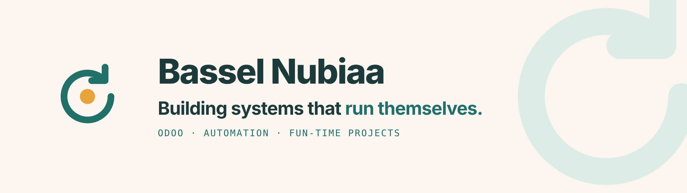

  

### Hi, I'm Bassel

I'm a Computer & Automatic Control engineer. In control engineering you design systems that measure, decide and correct themselves, and I bring that same idea to everything I build.

**By day** I implement and customize **Odoo ERP**. I've delivered 13+ projects in construction, manufacturing, trading and renewable energy, across the UAE, Kuwait, Iraq and Congo.

**The rest of the time** I build **fun-time projects**: things I make to teach myself a new skill and sharpen the ones I have.

---

### What I do

- **Odoo implementation, from start to finish:** requirements, gap analysis, process design, go-live and training
- **Business logic & automation:** Python server actions, automated actions, custom data models
- **Reports & views:** XML / QWeb customization
- **Project costing:** estimates, BoQ, analytic accounting, estimated vs. actual cost
- **Odoo addons:** custom modules from real implementation projects. See [odoo-addons](https://github.com/Bassel-Nubiaa/odoo-addons) *(work in progress)*
### Fun-time projects

| Project | What it does | What it taught me |
|---|---|---|
| [**MotionForge**](https://github.com/Bassel-Nubiaa/MotionForge) | Turns a simple JSON file into a 60-second motion graphics video. An AI writes the JSON from a topic, and the engine renders it in Google Colab with Remotion. No designing or rendering by hand. | React-based video, rendering pipelines, prompt design |
| *More coming soon* | | |

### Toolbox

`Python` · `Odoo (ORM, QWeb, server actions)` · `PostgreSQL` · `XML` · `JavaScript / React` · `Remotion` · `Google Colab` · `Make` · `Google Workspace`

### Find me

[LinkedIn](https://www.linkedin.com/in/bassel-nubiaa/) · [Email](mailto:bassel.nubiaa98@gmail.com) · Open to remote work and relocation
